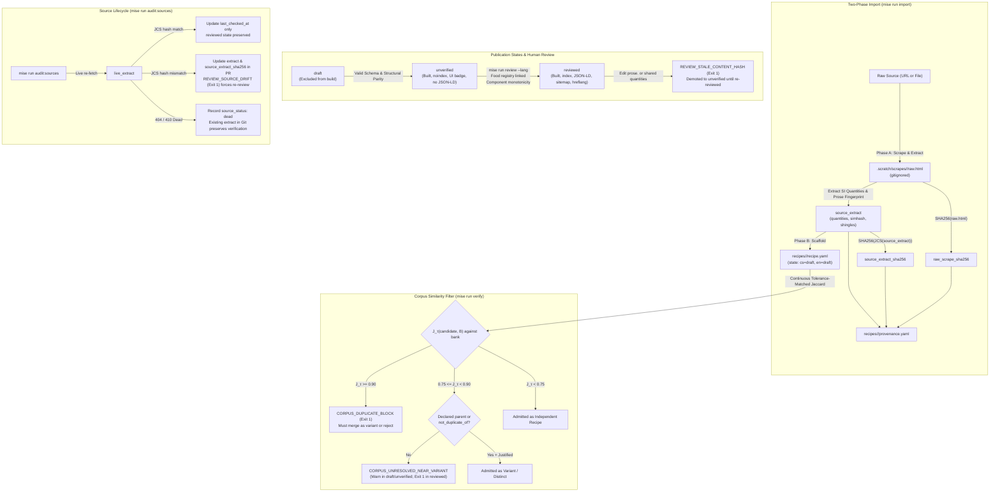
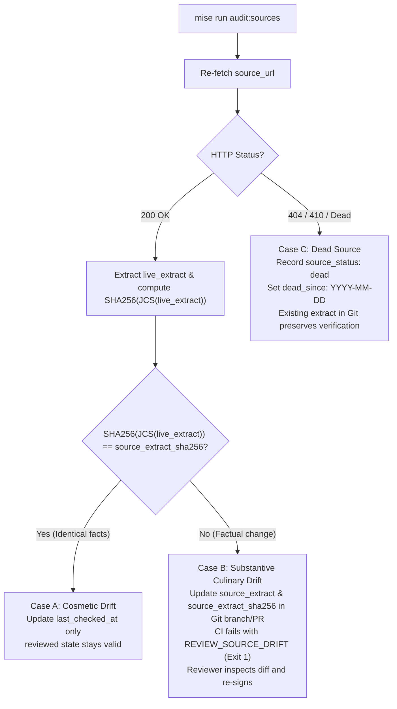

# ADR-0009: Content pipeline, tolerance-matched Jaccard similarity, cryptographic review binding, and publication states

- Status: Accepted
- Date: 2026-10-25
- Decided in: ticket *Content pipeline and publication states* (#10), after adversarial challenge on continuous Jaccard, dual-hash provenance, per-language review projections, and component state monotonicity

## Context

Culinary Spec builds an open-access, bilingual (Czech and English) recipe collection with verifiable culinary ratios and zero-token step prose. Recipes enter the collection through two pathways: original culinary development, or adaptation from external culinary sources (historical gastronomy texts, chef publications, community recipe databases).

Culinary formulas—the quantitative ratios of ingredients, cooking temperatures, and physical processing times—are factual scientific instructions that belong in the public culinary domain. Conversely, the creative prose, narrative headnotes, formatting, and photography in external publications are protected under international copyright law.

Transforming a recipe from an external source or original authoring into a published, verified, and indexed web document presents six interconnected architectural challenges:

1. **Plagiarism vs Factual Re-expression**: An automated or human workflow must reliably extract factual quantitative measurements without ingesting, copying, or machine-translating external copyrighted prose. Both Czech and English instructions must be freshly written original texts.
2. **Corpus Formula Duplication and Variant Sprawl**: In a curated recipe collection, admitting duplicate formulas (e.g. three virtually indistinguishable béchamel recipes differing only by a pinch of salt) degrades search quality and wastes reader attention. Discrete ingredient-name set overlap (standard Jaccard) fails because recipes sharing the exact same foods (e.g. flour, butter, milk) produce radically different dishes depending on ratios (a thin white sauce vs a thick soufflé base), while minor ingredient swaps (e.g. shallots vs onions) unfairly reduce naive set similarity. We require a continuous, tolerance-matched bipartite similarity metric that evaluates ingredient ratios on normalized physical dimensions.
3. **Offline CI Determinism vs Git Scrape Bloat**: Raw scraped HTML and JSON payloads contain copyrighted text, advertising trackers, tracking pixels, and volatile markup that bloat Git repositories and risk copyright infringement if committed. Yet, CI verification runs must be 100% deterministic, offline, and airgapped (ADR-0002, ADR-0008), failing closed with exit code 2 if provenance is missing. We require a dual-hash architecture: storing raw scrapes in gitignored local cache while committing normalized, canonicalized factual digests and cryptographic digests into Git.
4. **Asynchronous Bilingual Editorial Lifecycle**: Recipes are authored natively and in parallel in Czech (`cs`) and English (`en`). Initial drafting, translation, culinary testing, and human editorial review occur asynchronously. A Czech recipe must not be held back from publication because the English version is still an unverified draft; conversely, subsequently refining English prose or fixing an English typo must never invalidate a verified Czech editorial sign-off.
5. **Component State Monotonicity**: Recipes frequently compose other sub-recipes as components (e.g. lasagna referencing bolognese and béchamel components, ADR-0001, ADR-0006). If a parent recipe is promoted to `reviewed` and indexed by search engines while one of its consumed components remains in `draft` or `unverified`, readers and crawlers encounter broken dependency links or unverified sub-formulas. The publication state of composite dishes must be monotonic with respect to all referenced components.
6. **External Source Drift and Link Rot**: External websites frequently redesign their layouts, alter ingredient specifications, or disappear entirely (HTTP 404/410). Offline CI verification must never depend on live network probes. An out-of-band audit mechanism must cleanly distinguish between cosmetic HTML changes, substantive culinary formula revisions, and dead URLs without silently invalidating published recipes.

---

## Decision

We establish the normative specification for the Culinary Spec content pipeline, spanning deterministic two-phase imports, continuous tolerance-matched Jaccard corpus filtering, publication state machine transitions, component state monotonicity, per-language cryptographic review binding, and source drift lifecycle management.



---

### 1. Two-Phase Deterministic Import (`mise run import`)

Content acquisition executes strictly through the deterministic CLI command:

```bash
mise run import <url-or-file> [--id <id>] [--parent <parent-id>]
```

The import process is divided into two decoupled phases: **Phase A (Scrape & Extract)** and **Phase B (Scaffold & Authoring)**.

#### Phase A: Scrape & Extract
1. **Raw Scrape Cache**:
   - The CLI fetches the external HTML or JSON payload and stores it in `.scratch/scrapes/<id>/raw.html`.
   - The `.scratch/` directory is explicitly excluded from version control via `.gitignore`. No copyrighted third-party markup or ad scripts are ever committed to the repository.
   - The SHA-256 digest of the raw payload is computed and recorded:
     $$\text{raw\_scrape\_sha256} = \text{SHA256}(\text{raw.html})$$
2. **Factual SI Extraction (`source_extract.quantities`)**:
   - The extractor parses ingredient listings, extracts numeric amounts, resolves units, and matches food names against canonical entries in `data/foods.yaml`.
   - All extracted amounts are converted to standard canonical SI base units ($g$ for mass, $ml$ for volume, `piece` for dimensionless counts) using the conversion tables defined in ADR-0004.
   - The raw source string is preserved verbatim for auditability.
3. **Prose Fingerprinting (`source_extract.prose_fingerprint`)**:
   - The extractor extracts the source instruction prose, strips all HTML tags, converts characters to lowercase, strips punctuation, and normalizes whitespace into single-space tokens.
   - A 64-bit Hamming SimHash (`simhash`) is computed across character 4-grams to identify global structural text similarity.
   - An ordered sequence of 8-word shingle hashes (`shingle_hashes`) is generated via MurmurHash3 / SHA-256 across consecutive 8-word sliding windows to detect localized phrase lifting.
   - The raw word count of the source prose is recorded in `word_count`.
4. **Canonical Factual Digest (`source_extract_sha256`)**:
   - The structured extract object (`source_extract`) is serialized into canonical JSON using the **RFC 8785 JSON Canonicalization Scheme (JCS)**.
   - The SHA-256 digest is computed over the canonical JCS byte stream:
     $$\text{source\_extract\_sha256} = \text{SHA256}(\text{JCS}(\text{source\_extract}))$$
   - `recipes/<id>/provenance.yaml` is written with `raw_scrape_sha256`, `source_extract_sha256`, `retrieved_at`, `source_url`, and `source_extract`.

#### Phase B: Scaffold & Authoring
1. **Scaffolding `recipes/<id>/recipe.yaml`**:
   - Generates a valid recipe skeleton carrying an immutable 6-character Crockford Base32 `uid` (ADR-0006, ADR-0007), `id`, `yield`, `timings` (`prep_minutes`, `cook_minutes`, `rest_minutes`), and canonical ingredients derived from `source_extract.quantities`.
   - Both language states are initialized to `draft`:
     ```yaml
     state:
       cs: draft
       en: draft
     ```
2. **Zero-Token Original Prose Authoring**:
   - **Absolute prohibition**: Phase B never copies, translates, or paraphrases external prose into `steps[].prose`.
   - Step instructions must be authored from scratch in Czech and English by human writers, describing culinary actions using the plain, natural vocabulary of the kitchen (ADR-0006 zero-token rule).

---

### 2. Continuous Tolerance-Matched Bipartite Jaccard ($J_\tau$) Against the Recipe Bank

To protect corpus distinctiveness and prevent formula duplication, every recipe candidate is evaluated against every existing recipe in the corpus using a continuous, tolerance-matched bipartite similarity metric.

#### Formal Mathematical Definition of $J_\tau$

Let recipe $R$ have yield amount $Y_R = R.\text{yield.amount}$ (in servings or defined units) and non-optional ingredient instances $\mathcal{I}_R = \{ I \in R.\text{ingredients} \mid \neg I.\text{optional} \}$.

1. **Normalized Per-Serving Quantity $q_R(f, d)$**:
   Each non-optional ingredient $I$ has a canonical food identifier $f \in \text{FoodIDs} \cup \{\text{null}\}$ and a physical dimension $d \in \{\text{mass}, \text{volume}, \text{count}\}$.
   The canonical per-serving SI amount $q_R(f, d)$ is defined as the sum of all ingredient instances for that food and dimension, divided by the yield:
   $$q_R(f, d) = \frac{\sum \{ I.\text{amount\_si} \mid I \in \mathcal{I}_R, I.\text{food} = f, I.\text{dim} = d \}}{Y_R}$$
   *(Note: If an ingredient has unlinked food identity `food: null`, the key is represented as $(f_{\text{raw}}, d)$ where $f_{\text{raw}}$ is the trimmed, lowercased raw ingredient string).*

2. **Ingredient Key Set $\mathcal{K}_R$**:
   The set of active ingredient keys for recipe $R$ is:
   $$\mathcal{K}_R = \{ (f, d) \mid q_R(f, d) > 0 \}$$

3. **Logarithmic Ratio Tolerance Match ($\tau = 0.15$)**:
   For any shared key $(f, d) \in \mathcal{K}_A \cap \mathcal{K}_B$, the quantities $q_A(f, d)$ and $q_B(f, d)$ are considered tolerance-matched within tolerance $\tau = 0.15$ ($\pm 15\%$) if and only if both are null or:
   $$\left|\ln\left(\frac{q_A(f, d)}{q_B(f, d)}\right)\right| \le \ln(1 + \tau) = \ln(1.15) \approx 0.13976$$
   The natural logarithm ensures exact mathematical symmetry between $A$ and $B$:
   $$\left|\ln(q_A / q_B)\right| \le \ln(1.15) \iff \frac{1}{1.15} \le \frac{q_A(f, d)}{q_B(f, d)} \le 1.15$$

4. **Matched Key Set $\mathcal{M}_\tau(A, B)$**:
   The subset of shared keys whose per-serving quantities match within tolerance:
   $$\mathcal{M}_\tau(A, B) = \left\{ (f, d) \in \mathcal{K}_A \cap \mathcal{K}_B \;\middle|\; \left|\ln\left(\frac{q_A(f, d)}{q_B(f, d)}\right)\right| \le \ln(1.15) \right\}$$

5. **Tolerance-Matched Bipartite Jaccard Index $J_\tau(A, B)$**:
   $$J_\tau(A, B) = \frac{|\mathcal{M}_\tau(A, B)|}{|\mathcal{K}_A| + |\mathcal{K}_B| - |\mathcal{M}_\tau(A, B)|}$$

#### Properties of $J_\tau$
- **Identical Formulas**: If $A$ and $B$ share identical ingredients and all per-serving amounts match within $15\%$, then $|\mathcal{M}_\tau| = |\mathcal{K}_A| = |\mathcal{K}_B|$, yielding $J_\tau(A, B) = 1.0$.
- **Disjoint Formulas**: If $A$ and $B$ share no common ingredients, $|\mathcal{M}_\tau| = 0$, yielding $J_\tau(A, B) = 0.0$.
- **Ratio Divergence Penalty**: If $A$ and $B$ contain the same ingredients but in different proportions (e.g. crêpe batter vs pancake batter), keys exceeding the $15\%$ ratio tolerance are excluded from the numerator $|\mathcal{M}_\tau|$ while remaining in the denominator $(|\mathcal{K}_A| + |\mathcal{K}_B| - |\mathcal{M}_\tau|)$, smoothly depressing similarity.

#### Corpus Thresholds and Enforcement

| Jaccard Similarity $J_\tau(A, B)$ | Enforcement Gate | Verification Action |
|---|---|---|
| $J_\tau(A, B) \ge 0.90$ | **`CORPUS_DUPLICATE_BLOCK`** | **Error (Exit 1)**. Candidate formula is an impermissible duplicate of recipe $B$. Candidate cannot be admitted as an independent top-level recipe. It must either be rejected or merged as a variant of $B$ (`parent: <B.id>`). |
| $0.75 \le J_\tau(A, B) < 0.90$ | **`CORPUS_NEAR_VARIANT_WARN`** | **Warning in `draft` / `unverified`**; **Error (Exit 1) `CORPUS_UNRESOLVED_NEAR_VARIANT` in `reviewed`**. Candidate formula is closely related to $B$. Admissible only if declared with `parent: <B.id>`, or explicitly acknowledged in `provenance.yaml` (`not_duplicate_of: [{ id: <B.id>, rationale: "<string>" }]`) with culinary justification in `review.<lang>.notes`. |
| $J_\tau(A, B) < 0.75$ | Pass | Unique culinary formula. Admitted as independent recipe without restriction. |

#### Plagiarism Checks Against Adapted Source (`origin: adapted`)

In addition to corpus duplication checks, adapted recipes are evaluated against their own `source_extract` to verify authentic re-expression:

1. **Prose Plagiarism (8-Word Normalized Shingle Overlap)**:
   Let $S_{\text{source}}$ be the set of 8-word shingle hashes in `source_extract.prose_fingerprint.shingle_hashes`.
   Let $S_{\text{recipe}}$ be the set of 8-word shingle hashes computed over the concatenated step prose of the candidate recipe (in either Czech or English).
   The prose shingle overlap is:
   $$\text{overlap}(S_{\text{source}}, S_{\text{recipe}}) = \frac{|S_{\text{source}} \cap S_{\text{recipe}}|}{|S_{\text{recipe}}|}$$
   If $\text{overlap} > 0.05$ ($5\%$), `mise run verify:fast` fails with **`PROSE_PLAGIARISM_DETECTED` (Exit Code 1)**.
2. **Image Plagiarism (Perceptual Hash Hamming Distance)**:
   For every image referenced in `provenance.yaml` under `images`, the 64-bit DCT perceptual hash (`phash`) is evaluated against any scrape image digests.
   If Hamming distance $\text{dist}_H(\text{phash}_{\text{img}}, \text{phash}_{\text{scrape}}) \le 6$ (out of 64 bits) and `origin !== 'licensed'`, verification fails with **`IMAGE_DUPLICATE_OR_COPIED` (Exit Code 1)**.

---

### 3. Publication State Machine & Component State Monotonicity

#### Per-Language Publication States

Every recipe declares publication state independently for each supported language (`cs`, `en`):

```yaml
state:
  cs: reviewed
  en: unverified
```

The three valid states are `draft`, `unverified`, and `reviewed`.

#### Complete State Matrix

| Architectural Feature | `draft` | `unverified` | `reviewed` |
|---|---|---|---|
| **Build Emission (`dist/`)** | **Excluded**. Directory `dist/<lang>/...` is NOT created. | **Emitted**. Static HTML page emitted for editorial review, preview, and mobile QA. | **Emitted**. Static HTML page emitted for public indexing. |
| **UI Visual Badge** | N/A (not built). | **Mandatory Banner**. Visible warning banner rendered above recipe header: *"Neověřený recept — testovací verze"* / *"Unverified recipe — test version"*. | **No warning banner**. Subtle editorial verification stamp / metadata rendered. |
| **Search Indexing (`robots`)** | N/A (not built). | `<meta name="robots" content="noindex,follow">` (preserves outbound link equity to reviewed recipes and terms, matching ADR-0007). | `<meta name="robots" content="index,follow">` |
| **Search UI Discovery** | **Excluded**. | **Excluded by default**. Visible in search only when editor toggle `?include_unverified=1` is active (persisted in `localStorage`, never crawlable default). | **Included by default**. Core searchable corpus. |
| **JSON-LD (`schema.org/Recipe`)** | **Omitted**. | **Omitted**. `<script type="application/ld+json">` is completely stripped to prevent search scrapers from ingesting unverified data. | **Emitted**. Full, structured `schema.org/Recipe` emitted with ingredients, steps, timings, allergens, and nutrition. |
| **`sitemap.xml` & `hreflang`** | **Omitted** from sitemap and `hreflang` alternates. | **Omitted** from `sitemap.xml`. Excluded from `hreflang` alternates on other pages (ADR-0007). | **Included** in `sitemap.xml`. Emitted as `<link rel="alternate" hreflang="...">` across all companion `reviewed` pages. |
| **Verification Gates** | - Valid YAML syntax.<br>- Recipe `uid` valid Crockford Base32. | - All schema rules hold.<br>- Matrix laminarity or clean `phase-rail` fallback.<br>- Step DAG `consumes` acyclic.<br>- Structural language parity holds across non-draft locales.<br>- Unlinked ingredients (`food: null`) permitted.<br>- `published_at` optional. | - All `unverified` gates pass.<br>- 100% ingredients linked to `data/foods.yaml` (`food !== null`).<br>- `published_at` mandatory.<br>- `provenance.yaml` review sign-off present with matching cryptographic hash.<br>- Component monotonicity holds.<br>- Near-variants resolved. |

#### Component State Monotonicity

When a recipe references other recipes as components via the `ingredients[].component` field (ADR-0001, ADR-0006), composite dishes must not claim a higher degree of verification than their sub-recipes.

We define the strict total ordering of publication state ranks:
$$\text{rank}(\text{draft}) = 0 < \text{rank}(\text{unverified}) = 1 < \text{rank}(\text{reviewed}) = 2$$

**The Monotonicity Invariant**:
For every language $L \in \{\text{cs}, \text{en}\}$ and every component $C \in \{ C \mid I \in R.\text{ingredients}, I.\text{component} = C.\text{id} \}$:
$$\text{rank}(R.\text{state}[L]) \le \text{rank}(C.\text{state}[L])$$

If any recipe violates this invariant—e.g. recipe $R$ is marked `reviewed` in Czech ($\text{rank} = 2$) while component $C$ is marked `unverified` ($\text{rank} = 1$) or `draft` ($\text{rank} = 0$) in Czech—`mise run verify:fast` terminates with **`COMPONENT_STATE_INVERSION` (Exit Code 1)**.

Furthermore, component composition strictly adheres to a 2-level hierarchy: a parent dish (level 0) may consume component recipes (level 1), and a component recipe cannot itself consume further components (max edge depth = 1, ADR-0006). In the search index and facet filtering, referenced component ingredients and preparation minutes are restricted strictly to components actually built in that language (`COMPONENT_BUILD_AVAILABILITY`, ADR-0006, ADR-0010).

---

### 4. Human Check & Per-Language Cryptographic Review Binding ($\Pi_{\text{lang}}(R)$)

Promotion from `unverified` to `reviewed` requires explicit human culinary sign-off. This sign-off is bound cryptographically to a canonical projection of the recipe document, ensuring that future edits to text or quantities automatically invalidate the review.

#### The Interactive Review CLI (`mise run review`)

Editorial sign-off is performed using the interactive verification CLI:

```bash
mise run review <id> --lang <lang>
```

The CLI executes the following deterministic steps:
1. Validates that the recipe passes all structural `unverified` rules.
2. For adapted recipes (`origin: adapted`), presents an interactive, side-by-side terminal comparison between `source_extract.quantities` and the recipe's canonical per-serving SI quantities:
   ```
   ================================================================================
   CULINARY SPEC REVIEW: mornay-sauce [cs]
   Source: Le Guide Culinaire - Sauce Mornay Fact Sheet (https://example.com/classic-french-mornay)
   --------------------------------------------------------------------------------
   Ingredient Comparison (per serving):
     Food               Source Extract        Recipe Instance       Delta
     butter             7.5 g                 7.5 g                  0.0% [MATCH]
     flour-all-purpose  7.5 g                 7.5 g                  0.0% [MATCH]
     milk-whole         125.0 ml              125.0 ml               0.0% [MATCH]
     egg                0.25 piece            0.25 piece             0.0% [MATCH]
     cheese-gruyere     25.0 g                25.0 g                 0.0% [MATCH]
   --------------------------------------------------------------------------------
   Prose Similarity: Shingle Overlap = 0.0% (Threshold <= 5.0%) [PASS]
   Laminarity: OK (1 lane, 0 crossing intervals) [PASS]
   Allergens Derived: milk, gluten, eggs [PASS]
   ================================================================================
   Approve recipe 'mornay-sauce' for publication state 'reviewed' in [cs]? (y/N):
   ```
3. Upon human confirmation (`y`), prompts for reviewer name and optional notes.
4. Computes the canonical review hash $\text{SHA256}(\text{JCS}(\Pi_{\text{lang}}(R)))$.
5. Updates `recipes/<id>/provenance.yaml` under `review.<lang>`.
6. Sets `state.<lang>: reviewed` in `recipes/<id>/recipe.yaml`.

#### Canonical Language Projection $\Pi_{\text{lang}}(R)$

To prevent language crosstalk—where correcting an English typo would invalidate a verified Czech recipe—the cryptographic content hash is computed over the **canonical single-language projection** $\Pi_{\text{lang}}(R)$.

Let $R$ be the full parsed object of `recipes/<id>/recipe.yaml`.
$\Pi_{\text{lang}}(R)$ extracts a deterministic subset of fields:

1. **Included Shared Quantitative and Structural Fields**:
   - `id`, `uid`, `table_layout`
   - `yield` (`amount`, `unit`, `alternate`)
   - `timings` (`prep_minutes`, `cook_minutes`, `rest_minutes`)
   - `nutrition` (`basis`, `serving_size`, values)
   - `ingredients` (`id`, `food`, `component`, `amount`, `unit`, `alternate`, `scaling`, `optional`, `step`, `note`)
   - `prep_tasks` structural keys (`id`, `before_step`, `temp_c`, `time_minutes`)
   - `steps` structural keys (`id`, `phase`, `lane`, `temp_c`, `time_minutes`, `timers`, `consumes`)
2. **Included Language-Specific Text Fields for Target $\text{lang}$**:
   - `title[lang]`
   - `summary[lang]`
   - `slug[lang]`
   - `slug_aliases[lang]` (if present)
   - `prep_tasks[i].prose[lang]`
   - `steps[i].prose[lang]`
3. **Explicitly Excluded Fields**:
   - All text and slug fields for other languages (e.g. `title.en`, `summary.en`, `slug.en`, `steps[].prose.en` when $\text{lang} = \text{cs}$).
   - `state` (`state.cs`, `state.en`).
   - `published_at`.
   - File modification timestamps and git metadata.

The cryptographic review digest is defined as:
$$\text{recipe\_content\_sha256} = \text{SHA256}(\text{JCS}(\Pi_{\text{lang}}(R)))$$

#### Content Tamper Detection (`REVIEW_STALE_CONTENT_HASH`)

During every run of `mise run verify:fast`:
- For every language $L$ where $R.\text{state}[L] == \text{'reviewed'}$:
  1. Verify that `provenance.yaml` contains `review[L]`.
  2. Compute $\text{hash}_{\text{current}} = \text{SHA256}(\text{JCS}(\Pi_L(R)))$.
  3. Assert $\text{hash}_{\text{current}} == \text{provenance.review}[L].\text{recipe\_content\_sha256}$.
- If the hashes do not match, verification fails immediately with **`REVIEW_STALE_CONTENT_HASH` (Exit Code 1)**.
- Any subsequent edit to shared quantities (e.g. changing butter from 30g to 40g) or to localized prose in language $L$ invalidates the review hash. The author must either re-run `mise run review <id> --lang <lang>` or demote $R.\text{state}[L]$ back to `unverified`.

---

### 5. Source Drift & Lifecycle After Import (`mise run audit:sources`)

External web sources evolve independently of Culinary Spec. We enforce an uncompromising boundary between offline CI verification and out-of-band network audits.

#### The Offline CI Verification Boundary
Under no circumstances does `mise run verify` or `mise run verify:fast` perform network calls. CI verification is completely offline and airgapped.
In offline CI, `mise run verify:fast` asserts:
1. `provenance.yaml` exists for all adapted recipes (fails closed with **Exit Code 2** if missing).
2. `source_extract_sha256 == SHA256(JCS(source_extract))` (integrity of factual digest).
3. For every language $L$ where $R.\text{state}[L] == \text{'reviewed'}$:
   $$\text{review}[L].\text{source\_extract\_sha256\_at\_review} == \text{source\_extract\_sha256}$$
   If these digests differ, verification fails with **`REVIEW_SOURCE_DRIFT` (Exit Code 1)**.

#### Out-of-Band Audit (`mise run audit:sources`)

An automated out-of-band runner (scheduled via GitHub Actions or triggered manually) re-scrapes source URLs to evaluate drift across three distinct scenarios:



- **Case A: Cosmetic HTML Drift**:
  - The source website changed CSS styles, updated advertising tags, or restructured navigation, but culinary quantities and instructions are unchanged.
  - Re-extracting yields `live_extract` where $\text{SHA256}(\text{JCS}(\text{live\_extract})) == \text{source\_extract\_sha256}$.
  - Action: Update `last_checked_at` timestamp in `provenance.yaml`. The `review.<lang>` signatures remain fully valid; no editorial action required.
- **Case B: Substantive Culinary Drift**:
  - The external author modified recipe facts (e.g. reduced sugar from 150g to 100g, or changed oven temperature from 180°C to 200°C).
  - Re-extracting yields $\text{SHA256}(\text{JCS}(\text{live\_extract})) \ne \text{source\_extract\_sha256}$.
  - Action: The audit runner creates a new Git branch and opens a Pull Request updating `.scratch/scrapes/<id>/raw.html`, `raw_scrape_sha256`, `source_extract`, and `source_extract_sha256`.
  - Impact: CI on the PR automatically fails with **`REVIEW_SOURCE_DRIFT` (Exit Code 1)** because `source_extract_sha256_at_review` still references the prior digest.
  - Resolution: A human reviewer inspects the factual diff, decides whether our recipe should adopt the upstream revision or retain its existing formula, updates `recipe.yaml` if needed, and executes `mise run review <id> --lang <lang>` to re-sign.
- **Case C: Source Vanished (HTTP 404, 410, or Paywalled)**:
  - The source website went offline, deleted the post, or placed it behind a paywall.
  - Action: The audit runner updates `provenance.yaml` with `source_status: 'dead'`, `dead_since: 'YYYY-MM-DD'`, and an optional `archive_url` (e.g. Internet Archive Wayback Machine link).
  - Impact: Existing `source_extract` and `source_extract_sha256` remain checked into Git. Verification continues to pass offline; culinary recipes never break due to third-party link rot.

---

## Worked Example

### `recipes/mornay-sauce/provenance.yaml`

```yaml
origin: adapted
license: CC-BY-SA-4.0
source_url: https://example.com/classic-french-mornay
source_title: Le Guide Culinaire - Sauce Mornay Fact Sheet
retrieved_at: "2026-10-25T12:00:00Z"
last_checked_at: "2026-10-25T12:00:00Z"
source_status: alive

raw_scrape_sha256: 4f53cda18c2baa0c0354bb5f9a3ecbe5ed12ab4d8e11ba873c2f11161202b945
source_extract_sha256: a8b3d6c19f2e4b7a8d0c2e4f6a8b0c2d4e6f8a0b2c4d6e8f0a2b4c6d8e0f2a4b

not_duplicate_of:
  - id: bechamel-sauce
    rationale: "Classic French mother sauce derivative enriched with egg yolk and Gruyère cheese; distinct culinary class."

source_extract:
  quantities:
    - amount: 30
      unit: g
      food: butter
      raw: 30 g de beurre
    - amount: 30
      unit: g
      food: flour-all-purpose
      raw: 30 g de farine
    - amount: 500
      unit: ml
      food: milk-whole
      raw: 1/2 litre de lait
    - amount: 1
      unit: piece
      food: egg
      raw: 1 jaune d'oeuf
    - amount: 100
      unit: g
      food: cheese-gruyere
      raw: 100 g de gruyère râpé
  prose_fingerprint:
    simhash: "0x8f2d4e1a9b3c5d7e"
    shingle_hashes:
      - "0x3a4f12"
      - "0x9c8b74"
      - "0x12ed5a"
      - "0x7b6e91"
      - "0x4f8a23"
    word_count: 145

review:
  cs:
    reviewed_by: Martin Šmíd
    reviewed_at: "2026-10-25T14:30:00Z"
    recipe_content_sha256: 4a2b6c8d1e3f5a7b9c0d2e4f6a8b0c2d4e6f8a0b2c4d6e8f0a2b4c6d8e0f2a4b
    source_extract_sha256_at_review: a8b3d6c19f2e4b7a8d0c2e4f6a8b0c2d4e6f8a0b2c4d6e8f0a2b4c6d8e0f2a4b
    notes: "Proportions verified against Escoffier reference; confirmed original Czech prose methods; matrix laminarity verified."
  en:
    reviewed_by: Martin Šmíd
    reviewed_at: "2026-10-25T14:45:00Z"
    recipe_content_sha256: 7f8e9a0b1c2d3e4f5a6b7c8d9e0f1a2b3c4d5e6f7a8b9c0d1e2f3a4b5c6d7e8f
    source_extract_sha256_at_review: a8b3d6c19f2e4b7a8d0c2e4f6a8b0c2d4e6f8a0b2c4d6e8f0a2b4c6d8e0f2a4b
    notes: "Proportions verified against Escoffier reference; confirmed original English prose methods; terminology matches culinary glossary."

images:
  - file: hero.webp
    origin: licensed
    license: CC-BY-SA-4.0
    source_url: https://commons.wikimedia.org/wiki/File:Sauce_Mornay.jpg
    phash: d4c3b2a10f9e8d7c
```

---

## Verification & Mutant Matrix Additions

### Verification Rules

| Rule | Severity | Deterministic Condition |
|---|---|---|
| `CORPUS_DUPLICATE_BLOCK` | Error (Exit 1) | Candidate recipe has continuous tolerance-matched Jaccard $J_\tau(A, B) \ge 0.90$ against an existing corpus recipe. Candidate must be merged as a variant or rejected. |
| `CORPUS_UNRESOLVED_NEAR_VARIANT` | Error (Exit 1) | Recipe in `reviewed` state has $0.75 \le J_\tau(A, B) < 0.90$ against existing recipe $B$ without either `parent: <B.id>` or explicit `not_duplicate_of: [{ id: <B.id>, rationale: "<string>" }]` in `provenance.yaml` with notes justification. |
| `PROSE_PLAGIARISM_DETECTED` | Error (Exit 1) | Adapted recipe step prose has 8-word normalized shingle overlap $> 0.05$ ($5\%$) against `source_extract.prose_fingerprint`. |
| `IMAGE_DUPLICATE_OR_COPIED` | Error (Exit 1) | Recipe image has 64-bit DCT perceptual hash Hamming distance $\le 6$ against scrape image digest while `origin !== 'licensed'`. |
| `REVIEW_STALE_CONTENT_HASH` | Error (Exit 1) | Recipe in `reviewed` state has $\text{SHA256}(\text{JCS}(\Pi_L(R))) \ne \text{provenance.review}[L].\text{recipe\_content\_sha256}$, indicating unreviewed edits to shared quantities or locale prose. |
| `REVIEW_SOURCE_DRIFT` | Error (Exit 1) | Recipe in `reviewed` state has `review[L].source_extract_sha256_at_review !== source_extract_sha256`, indicating unreviewed upstream culinary drift. |
| `COMPONENT_STATE_INVERSION` | Error (Exit 1) | Recipe in state $S$ references a component with publication rank $\text{rank}(R.\text{state}[L]) > \text{rank}(C.\text{state}[L])$ in the same language. |

### Mutant Catalog Additions (Mutants 38–44)

The 7 additions define mutants 38–44 (see ADR-0008 §5 for the complete 54-mutant matrix):

| # | Mutant ID | Originating ADR | Expected Rule Code | Exit Code | Injected Defect | Tier |
|---|---|---|---|---|---|---|
| 38 | `mutant-corpus-duplicate-block` | ADR-0009 | `CORPUS_DUPLICATE_BLOCK` | 1 | Candidate recipe has tolerance-matched Jaccard $J_\tau \ge 0.90$ against existing corpus recipe. | Fast |
| 39 | `mutant-corpus-unresolved-near-variant` | ADR-0009 | `CORPUS_UNRESOLVED_NEAR_VARIANT` | 1 | Recipe promoted to `reviewed` with $0.75 \le J_\tau < 0.90$ without `parent` or `not_duplicate_of` justification. | Fast |
| 40 | `mutant-prose-plagiarism-detected` | ADR-0009 | `PROSE_PLAGIARISM_DETECTED` | 1 | Adapted recipe contains verbatim 8-word phrases from source extract exceeding $5\%$ shingle overlap. | Fast |
| 41 | `mutant-image-duplicate-or-copied` | ADR-0009 | `IMAGE_DUPLICATE_OR_COPIED` | 1 | Recipe image has perceptual hash Hamming distance $\le 6$ against scrape image without licensing metadata. | Fast |
| 42 | `mutant-review-stale-content-hash` | ADR-0009 | `REVIEW_STALE_CONTENT_HASH` | 1 | Step prose or shared ingredient amount modified in `reviewed` recipe without re-executing `mise run review`. | Fast |
| 43 | `mutant-review-source-drift` | ADR-0009 | `REVIEW_SOURCE_DRIFT` | 1 | `source_extract_sha256` updated following upstream source drift, but `review[L]` still carries old extract hash. | Fast |
| 44 | `mutant-component-state-inversion` | ADR-0009 | `COMPONENT_STATE_INVERSION` | 1 | Recipe in `reviewed` state references a component whose state in that language is `unverified` or `draft`. | Fast |

---

## Consequences

### Positive
- **Guaranteed Re-expression & Legal Safety**: The pipeline enforces a strict physical separation between scraped source artifacts (gitignored) and factual extracts (in Git), paired with automated shingle overlap and perceptual hash tests that block plagiarism at pre-commit and CI.
- **Corpus Quality & Distinctiveness**: Continuous tolerance-matched Jaccard ($J_\tau$) prevents formula clutter and duplicate recipes while distinguishing between culinary cousins and true duplicates through logarithmic ratio tolerances.
- **Asynchronous Bilingual Velocity**: Decoupled cryptographic review hashes ($\Pi_{\text{lang}}(R)$) allow Czech and English content to evolve and publish at their own pace without invalidating each other's verified status.
- **Zero Airgap Vulnerability**: Offline CI never makes live HTTP requests. External link rot or source website changes cannot break offline test runs or pull request gates.
- **Monotonic Dependency Trees**: Readers and search engine crawlers are guaranteed that every component referenced by a published, reviewed dish is itself fully reviewed and indexed.

### Negative
- **Review Invalidation Friction**: Any subsequent edit to shared quantities or localized prose invalidates the cryptographic review hash, requiring the author to re-run `mise run review <id> --lang <lang>` before CI will pass.
- **Near-Variant Justification Overhead**: Formulas landing in the $0.75 \le J_\tau < 0.90$ band require explicit manual acknowledgement and rationale before promotion to `reviewed`.

---

## Rejected

- **Direct Ingestion of Scraped Prose**: Rejected allowing automated machine translation or direct copying of external instructions into `recipe.yaml`. All prose must be 100% human-authored to ensure legal compliance and avoid grammatical defects under Slavic inflection.
- **Discrete Ingredient-Name Jaccard**: Rejected naive set Jaccard similarity based solely on ingredient name tokens. Naive Jaccard ignores ingredient quantities, confusing thin sauces with thick roux, while over-penalizing trivial ingredient substitutions.
- **Global Recipe-Level Review Hash**: Rejected computing a single cryptographic hash across the entire `recipe.yaml` document. A global hash creates catastrophic cross-language coupling: fixing an English typo would immediately demote a fully tested Czech recipe from `reviewed` to `unverified`.
- **Live HTTP Probes in `mise run verify`**: Rejected pinging source URLs during standard verification. Live network dependencies cause flaky CI runs, slow down local authoring hooks (`hk`), and break airgapped development environments.
- **Silent Automatic Re-signing on Source Drift**: Rejected automatically updating review hashes when an external recipe changes. Upstream culinary changes must be surfaced to human editors to evaluate whether our recipe should adopt the modification.
- **Allowing Unverified Components in Reviewed Dishes**: Rejected permitting a `reviewed` master dish to reference `draft` or `unverified` components, which would break the reader experience and leak unfinished sub-recipes into production builds.
