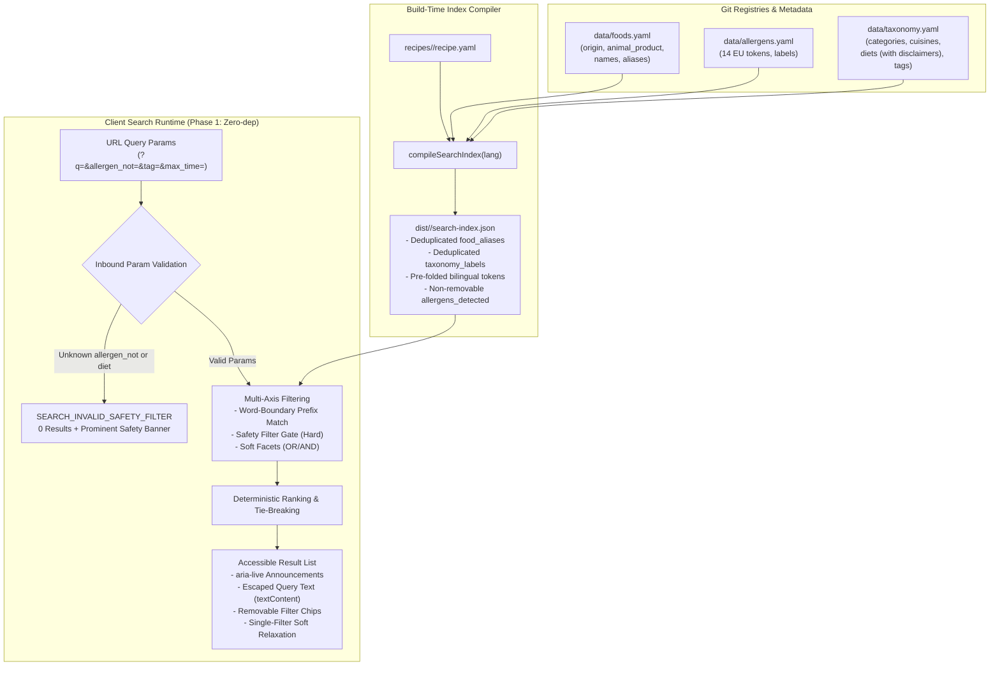

# ADR-0010: Search, facets, controlled taxonomy, and allergen safety filtering

- Status: Accepted
- Date: 2026-10-26
- Decided in: ticket *Search, facets and tagging* (#11), after two-phase challenger review and four-axis adversarial grilling

## Context

A static-first bilingual cookbook (Czech and English) requires a fast, accessible, and safe way for a reader to answer the fundamental daily question: *"What can I cook tonight with what I have, within my time limit, and without poisoning my family?"*

Previous static site search architectures and recipe platforms fail under the simultaneous constraints of Culinary Spec (ADR-0001 through ADR-0009):

1. **Slavic Inflection vs Runtime Stemmers**: Czech is a fusional Slavic language with 7 noun cases, 4 plural paradigms, and widespread consonant alternations (`cibule` / `cibuli` / `cibulí`, `mouka` / `mouce`). Runtime NLP lemmatizers (e.g. morphological analyzers like MorphoDiTa) require multi-megabyte dictionary payloads that destroy mobile load budgets, violate offline static compilation principles, and still fail on culinary loanwords (`sous-vide`, `gnocchi`, `parmigiano`). Conversely, naive exact substring matching (`includes`) matches mid-word fragments arbitrarily (`"sul"` hitting `"kapsule"`, `"na"` hitting `"smetana"`).
2. **Open Folksonomy vs Controlled Tagging**: Uncontrolled folksonomy tagging leads to rapid taxonomy collapse: synonym proliferation (`rychle`, `rychla-vecere`, `do-30-min`), casing/hyphenation drift, and single-recipe orphan tags. On static hosting, generating a tag index page for every arbitrary tag produces thin pages that harm search engine crawl equity and dilute domain indexing authority (ADR-0007). Furthermore, renaming tags without a permanence layer causes link rot for bookmarked URLs.
3. **Safety Loopholes in Allergen & Diet Invariants**: In recipe databases, diet labels (`vegan`, `gluten-free`, `dairy-free`) are routinely treated as informal marketing metadata authored by writers without verification. A recipe containing butter and declaring `allergens_remove: milk` (e.g. for clarified butter / ghee) might pass a naive `lactose-free` or `vegan` filter if the check only inspects `allergens.mandatory`. Similarly, a recipe variant that substitutes flour might still contain gluten if the base document is evaluated carelessly. For readers with celiac disease or severe anaphylactic allergies, laundering an allergen through metadata is a critical medical safety hazard.
4. **Silent Filter Widening on Inbound Typos**: Inbound URLs arriving from shared links or bookmarks may contain mistyped parameter values (e.g. `?allergen_not=glutne` or `?diet=vegen`). Naive search engines ignore unrecognized filter tokens and return the full unfiltered corpus while still displaying an active filter chip in the UI. For medical-adjacent safety filters, silently dropping an unknown constraint and displaying allergen-bearing dishes is an unacceptable failure mode.
5. **Facet Permutation Crawl-Budget Waste**: A facet filter UI with multiple orthogonal axes (`category`, `cuisine`, `tag`, `diet`, `difficulty`, `max_time`, `food`) generates an exponential permutation space of unique URLs. If search pages are crawlable or followable by search engine bots, web crawlers waste crawl budget traversing millions of redundant facet permutations, degrading the indexing authority of canonical recipe pages.
6. **Cross-Lingual State Loss on Search Queries**: ADR-0007 guarantees zero kitchen state loss when toggling between Czech and English (`#lang-switch`). While numeric parameters (`yield`, `max_time`) forward cleanly, free-text queries (`?q=omáčka`) naively return zero results if evaluated against a purely localized index on `/en/search/`.
7. **Client Size and Keystroke Latency Ceilings**: A client search engine must deliver instant keystroke filtering ($\text{INP} \le 100\text{ ms}$, input-to-paint $\le 120\text{ ms}$) without exceeding the total JS budget of $\le 35\text{ kB}$ gzip (ADR-0008). Large full-text client search bundles (e.g. Lunr, FlexSearch) or unoptimized per-recipe text duplicates bloat the client bundle and JSON payload.

---

## Decision

We establish the normative specification for search facets, controlled taxonomy, allergen safety filtering, build-time search index generation, client search execution, and accessible empty-state relaxation.



---

### 1. Controlled Taxonomy Registry (`data/taxonomy.yaml`)

All recipe classification tags, categories, cuisines, and diets are governed by a single versioned file: `data/taxonomy.yaml`. Open folksonomy tagging is strictly prohibited.

#### Taxonomy Groups
The taxonomy defines exactly four closed groups:
1. `categories`: High-level dish classification for `schema.org/recipeCategory` (e.g. `sauce`, `soup`, `main`, `dessert`, `baking`, `appetizer`, `salad`, `side`).
2. `cuisines`: Culinary tradition for `schema.org/recipeCuisine` (e.g. `czech`, `french`, `italian`, `mediterranean`, `asian`, `middle-eastern`).
3. `diets`: Medically or philosophically significant dietary profiles (`gluten-free`, `dairy-free`, `lactose-free`, `vegetarian`, `vegan`).
4. `tags`: Descriptive culinary tags covering meal types, methods, and occasions (e.g. `quick`, `one-pot`, `comfort-food`, `meal-prep`, `fermented`, `cold-weather`, `summer`).

```yaml
# data/taxonomy.yaml
categories:
  - id: sauce
    label: { cs: "Omáčky", en: "Sauces" }
    description: { cs: "Základní a teplé restaurační omáčky", en: "Mother sauces and warm pan sauces" }
  - id: main
    label: { cs: "Hlavní jídla", en: "Main Dishes" }
    description: { cs: "Sytá hlavní jídla a pečeně", en: "Hearty main courses and braises" }

cuisines:
  - id: czech
    label: { cs: "Česká", en: "Czech" }
  - id: french
    label: { cs: "Francouzská", en: "French" }

diets:
  - id: gluten-free
    label: { cs: "Bezlepková", en: "Gluten-Free" }
    disclaimer:
      cs: "Recept neobsahuje suroviny s lepkem. Nejedná se o certifikovaný bezlepkový provoz; zkontrolujte původ zpracovaných surovin."
      en: "Recipe contains no gluten-bearing ingredients. Not a certified gluten-free kitchen; verify processed ingredient sources."
    forbid_allergens: [gluten]
  - id: dairy-free
    label: { cs: "Bez mléka", en: "Dairy-Free" }
    disclaimer:
      cs: "Recept neobsahuje mléko ani mléčné výrobky. Nejedná se o certifikovaný provoz; nezaručuje nepřítomnost stop z křížové kontaminace."
      en: "Recipe contains no milk or dairy products. Not a certified facility; does not guarantee absence of kitchen cross-contamination."
    forbid_allergens: [milk]
    forbid_animal_products: [dairy]
  - id: lactose-free
    label: { cs: "Bez laktózy", en: "Lactose-Free" }
    disclaimer:
      cs: "Recept neobsahuje suroviny s obsahem laktózy. Obsahuje-li přepuštěné máslo (ghee), mléčné bílkoviny a cukry byly odstraněny. Nejedná se o certifikovaný provoz bez křížové kontaminace."
      en: "Recipe contains no lactose-bearing ingredients. Clarified butter (ghee), if used, has milk solids and sugars removed. Does not guarantee absence of kitchen cross-contamination."
    forbid_mandatory_allergens: [milk]
  - id: vegetarian
    label: { cs: "Vegetariánská", en: "Vegetarian" }
    disclaimer:
      cs: "Recept neobsahuje maso, drůbež, ryby, korýše ani měkkýše. Nezaručuje nepřítomnost stop z kuchyňské křížové kontaminace."
      en: "Recipe contains no meat, poultry, fish, crustaceans, or molluscs. Does not guarantee absence of kitchen cross-contamination."
    forbid_allergens: [fish, crustaceans, molluscs]
    forbid_animal_products: [meat, poultry, fish, crustacean, mollusc]
  - id: vegan
    label: { cs: "Veganská", en: "Vegan" }
    disclaimer:
      cs: "Čistě rostlinný recept bez jakýchkoliv živočišných produktů. Nezaručuje nepřítomnost stop z kuchyňské křížové kontaminace."
      en: "Purely plant-based recipe with zero animal products. Does not guarantee absence of kitchen cross-contamination."
    forbid_allergens: [milk, eggs, fish, crustaceans, molluscs]
    forbid_origins: [animal]

tags:
  - id: quick
    label: { cs: "Rychlé do 30 min", en: "Quick under 30 min" }
  - id: one-pot
    label: { cs: "Z jednoho hrnce", en: "One-Pot" }
  - id: comfort-food
    label: { cs: "Syté & hřejivé", en: "Comfort Food" }
  - id: classic
    label: { cs: "Klasické", en: "Classic" }
  - id: gratin
    label: { cs: "Zapečené & gratinované", en: "Gratin & Baked" }
  - id: bistro
    label: { cs: "Bistro klasika", en: "Bistro Classic" }
```

#### Taxonomy Invariants:
1. **Global ID Uniqueness (`TAXONOMY_ID_GLOBAL_UNIQUE`, Exit 1)**: Every `id` across all four groups (`categories`, `cuisines`, `diets`, `tags`) must be lowercase ASCII kebab-case (`^[a-z0-9]+(-[a-z0-9]+)*$`) and globally unique across the entire taxonomy file. All four groups (`categories`, `cuisines`, `diets`, `tags`) share a single global ID namespace; no ID may appear in more than one group.
2. **Tag ID Immutability (`TAXONOMY_ID_IMMUTABLE`, Exit 1)**: Taxonomy IDs are frozen and tracked in a committed lockfile `data/taxonomy.lock`. Existing IDs cannot be deleted or renamed in-place.
3. **Deprecation & 301 Redirect Stubs (`TAG_ALIAS_INTEGRITY`, Exit 1)**: A taxonomy entry may be retired by adding `deprecated_in_favor_of: <active-id>`. The build pipeline emits static 301 HTML redirect stubs at `/<lang>/stitky/<old-id>/` and `/<lang>/tags/<old-id>/` redirecting to the canonical replacement tag URL.
4. **Thin Tag Page Robots Policy (`TAG_THIN_PAGE`, Exit 1)**: Tag pages (`/<lang>/stitky/<tag-id>/` and `/<lang>/tags/<tag-id>/`) emit `<meta name="robots" content="index,follow">` **if and only if** the language has $\ge 2$ `reviewed` recipes carrying that tag; otherwise they emit `<meta name="robots" content="noindex,follow">` and are excluded from `sitemap.xml`.
5. **Recipe Tag Limits (`TAXONOMY_TAG_LIMIT_EXCEEDED`, Exit 1)**: A recipe may declare at most $\le 8$ tags in `tags`. This limit is strictly enforced to preserve recipe card layout density and chip visual budgets.
6. **No Duplicate Tag Instances (`TAG_DUPLICATE_INSTANCE`, Exit 1)**: A recipe cannot declare the same tag ID or diet ID multiple times within its respective array.

---

### 2. Authoritative Allergen Registry (`data/allergens.yaml`) & Biological Origin (`data/foods.yaml`)

#### Authoritative Allergen Registry (`data/allergens.yaml`)
To eliminate token name drift across documents, the 14 EU 1169/2011 allergens are authoritatively specified in `data/allergens.yaml`:

```yaml
# data/allergens.yaml
allergens:
  - id: gluten
    label: { cs: "Obiloviny obsahující lepek", en: "Cereals containing gluten" }
    aliases: { cs: ["lepek", "pšenice", "žito", "ječmen", "oves"], en: ["wheat", "rye", "barley", "oats"] }
  - id: crustaceans
    label: { cs: "Korýši", en: "Crustaceans" }
  - id: eggs
    label: { cs: "Vejce", en: "Eggs" }
  - id: fish
    label: { cs: "Ryby", en: "Fish" }
  - id: peanuts
    label: { cs: "Jádra podzemnice olejné (arašídy)", en: "Peanuts" }
  - id: soybeans
    label: { cs: "Sójové boby (sója)", en: "Soybeans" }
  - id: milk
    label: { cs: "Mléko", en: "Milk" }
  - id: nuts
    label: { cs: "Skořápkové plody (ořechy)", en: "Tree nuts" }
  - id: celery
    label: { cs: "Celer", en: "Celery" }
  - id: mustard
    label: { cs: "Hořčice", en: "Mustard" }
  - id: sesame
    label: { cs: "Sezamová semena", en: "Sesame seeds" }
  - id: sulphites
    label: { cs: "Oxid siřičitý a siřičitany", en: "Sulphur dioxide and sulphites" }
  - id: lupin
    label: { cs: "Vlčí bob (lupina)", en: "Lupin" }
  - id: molluscs
    label: { cs: "Měkkýši", en: "Molluscs" }
```

- **Registry Integrity (`ALLERGEN_REGISTRY_PRESENT`, Exit 2)**: Verification fails immediately with Exit 2 if `data/allergens.yaml` is missing, empty, or unparseable.
- **Token Validation (`ALLERGEN_CANONICAL_TOKEN`, Exit 1)**: Any food entry in `data/foods.yaml` or recipe authoring `allergens_add` / `allergens_remove` referencing an allergen outside these 14 tokens terminates verification with Exit 1.

#### Biological Origin in `data/foods.yaml`
To enforce vegetarian and vegan dietary claims without reviving rejected "supermarket aisle" categories (ADR-0005), `data/foods.yaml` includes pure biological classification:

- `origin`: `'plant' | 'animal' | 'fungi' | 'mineral' | 'synthetic'`. Mandatory on every food entry (`FOOD_ORIGIN_MISSING`, Exit 1).
- `animal_product` (optional): `'meat' | 'poultry' | 'fish' | 'crustacean' | 'mollusc' | 'dairy' | 'egg' | 'honey'`. Mandatory when `origin == 'animal'`.

```yaml
# Examples in data/foods.yaml
butter:
  id: butter
  origin: animal
  animal_product: dairy
  default_dimension: mass
  allergens: [milk]
  names: { cs: máslo, en: { one: butter, other: butter } }
  aliases: { cs: [másla, máslem, máslu], en: [sweet cream butter] }

lard:
  id: lard
  origin: animal
  animal_product: meat
  default_dimension: mass
  allergens: []
  names: { cs: sádlo, en: { one: lard, other: lard } }

chanterelle:
  id: chanterelle
  origin: fungi
  default_dimension: mass
  allergens: []
  names: { cs: liška obecná, en: { one: chanterelle, other: chanterelles } }

salt:
  id: salt
  origin: mineral
  default_dimension: mass
  allergens: []
  names: { cs: sůl, en: { one: salt, other: salt } }
```

---

### 3. Diet Claims, Disclaimers, and Non-Removable `allergens_detected`

Diet claims represent serious safety and ethical guarantees for readers. They must never rely on authored claims alone; they are verified deterministically against biological facts.

#### The Non-Removable Detected Sets
In ADR-0006 §7, `allergens.mandatory` is derived as `union(foods) + components + allergens_add - allergens_remove`. While `allergens_remove` is culinarily valid for display (e.g. ghee removing milk solids), **`allergens_remove` must never be used to launder a diet claim**.

The compiler derives three non-removable detected sets across all base ingredients (both mandatory and optional) and referenced components **before any additions or removals**:
1. `allergens_detected`: $\bigcup_{I \in \text{ingredients}} I.\text{food}.\text{allergens} \cup \bigcup_{C \in \text{components}} C.\text{allergens\_detected}$.
2. `origins_detected`: $\bigcup_{I \in \text{ingredients}} \{ I.\text{food}.\text{origin} \} \cup \bigcup_{C \in \text{components}} C.\text{origins\_detected}$.
3. `animal_products_detected`: $\bigcup_{I \in \text{ingredients}} \{ I.\text{food}.\text{animal\_product} \} \cup \bigcup_{C \in \text{components}} C.\text{animal\_products\_detected}$.

#### Verification Invariants:
1. **Zero Unlinked Ingredients on Diet Recipes (`DIET_UNLINKED_FOOD`, Exit 1)**: Any recipe declaring an entry in `diets` must have zero unlinked ingredients (`food !== null` on 100% of ingredient instances). An unlinked ingredient (`food: null`) cannot prove its biological origin or allergens.
2. **Conflict Rule Enforcement (`DIET_ALLERGEN_CONFLICT`, Exit 1)**:
   Diet claims evaluate `forbid_allergens` deterministically against `allergens_detected`, `origins_detected`, and `animal_products_detected`. The single documented exception is `lactose-free`, which evaluates `forbid_mandatory_allergens` against `allergens.mandatory` + `allergens.optional`:
   - `gluten-free`: declares `forbid_allergens: [gluten]`, forbidding `gluten` in `allergens_detected` (mandatory and optional).
   - `dairy-free`: declares `forbid_allergens: [milk]` and `forbid_animal_products: [dairy]`, forbidding `milk` in `allergens_detected` and `dairy` in `animal_products_detected`. Even if a recipe authors `allergens_remove: [{ allergen: milk, reason: ... }]` for ghee, `dairy-free` fails closed.
   - `lactose-free`: declares `forbid_mandatory_allergens: [milk]`, forbidding `milk` in `allergens.mandatory` + `allergens.optional` (permitting clarified butter/ghee where milk solids are removed with an explicit culinary reason in `allergens_remove`, or certified lactose-free substitutes).
   - `vegetarian`: declares `forbid_allergens: [fish, crustaceans, molluscs]` and `forbid_animal_products: [meat, poultry, fish, crustacean, mollusc]`. (Lard, gelatin, and fish stock fail closed immediately).
   - `vegan`: declares `forbid_allergens: [milk, eggs, fish, crustaceans, molluscs]` and `forbid_origins: [animal]`. (Honey, lard, butter, and gelatin fail closed immediately).
3. **Mandatory Diet Disclaimers (`DIET_DISCLAIMER_PRESENT`, Exit 1)**: Every diet in `data/taxonomy.yaml` must provide a bilingual `disclaimer: { cs, en }` explicitly informing the reader that the tag reflects authored recipe ingredients and does not guarantee the absence of kitchen cross-contamination. This disclaimer is rendered prominently next to the diet badge in UI layouts.
4. **Prohibition of "May Contain" Phrasing**: Optional ingredient allergens (`allergens.optional`) are authored variations, not unintentional factory cross-contamination. Copy is strictly: *"Volitelná surovina obsahuje <alergen> — lze vynechat / Optional ingredient contains <allergen> — can be omitted"*. The legally loaded FIC Regulation 1169/2011 phrase "may contain" is strictly prohibited. If an allergen appears in both a mandatory and an optional instance, it is treated as mandatory (excluded under `allergen_not` with no optional badge).

---

### 4. Allergen Exclusion (`allergen_not`) and Variant Safety Contract

The allergen exclusion filter (`?allergen_not=<token>`) is a medical-adjacent safety boundary. It adheres to a strict fail-closed contract:

#### Fail-Closed Inbound Filter Validation (`SEARCH_INVALID_SAFETY_FILTER`, Exit 1)
If the URL parameter `allergen_not` or `diet` contains any token not recognized by `data/allergens.yaml` or `data/taxonomy.yaml` (e.g. `?allergen_not=glutne` or `?diet=vegen`):
- The search engine **must not silently drop the unrecognized token**.
- The search engine **fails closed immediately**, returning **0 results**.
- The UI renders a prominent warning banner: *"Neznámý bezpečnostní filtr: <token>. Vyhledávání bylo z bezpečnostních důvodů zastaveno / Unrecognized safety filter: <token>. Search halted for safety."* with a one-click reset button.
- Conversely, unrecognized *soft* filters (`category`, `cuisine`, `tag`, `difficulty`, `max_time`, `food`, `q`, `include_unverified`) are ignored gracefully, but surface a non-blocking warning notice chip.

#### Fail-Closed on Unlinked Foods (`food: null`)
Whenever `allergen_not` or `diet` is active, any recipe carrying unlinked ingredients (`has_unlinked_food: true`, permitted in `unverified` status) is strictly excluded from results, even if `include_unverified=1` is active.

#### Variant Safety Evaluation (`SEARCH_VARIANT_LINK_INTEGRITY`, Exit 1)
A recipe whose base document contains an excluded allergen $E \in \text{allergen\_not}$ must never be returned as a standard result. However, Culinary Spec supports recipe variants (ADR-0006 §6) that substitute ingredients (e.g. gluten-free tamari for soy sauce, gluten-free flour for wheat flour).

To avoid false negatives while preventing variant laundering:
1. **Base Recipe Evaluation**: The base recipe matches `allergen_not` strictly on its own derived $\mathcal{A}_{\text{base}} = \text{allergens.mandatory}$.
2. **Materialized Variant Qualification**: If the base recipe is excluded, the engine iterates over its materialized variants. A variant $V$ qualifies if and only if its materialized document satisfies:
   $$(\mathcal{A}_V^{\text{mandatory}} \cup \mathcal{A}_V^{\text{optional}}) \cap E = \emptyset$$
   for the **entire** active excluded set $E$ simultaneously, where $\mathcal{A}_V^{\text{mandatory}}$, $\mathcal{A}_V^{\text{optional}}$, and $\mathcal{A}_V^{\text{detected}}$ are derived from the materialized variant document's effective ingredient instances ($\text{ingredients}(V)$ after applying `replace`, `add`, and `remove`, plus referenced components, and then applying $V.\text{allergens\_add}$ and $V.\text{allergens\_remove}$, matching ADR-0006 §6 & §7.1). A variant qualifies under `allergen_not` only when the excluded allergen was genuinely eliminated by an ingredient `replace` or `remove`—so that $E \cap \mathcal{A}_V^{\text{detected}} = \emptyset$ (or falls under the explicit lactose-free ghee exception)—making the non-removable allergen doctrine 100% explicit for variants as well (`SEARCH_VARIANT_LINK_INTEGRITY`). This ensures that a clean `replace` variant (e.g. swapping wheat flour for gluten-free flour) automatically clears `gluten` from $\mathcal{A}_V$ via its replaced food instances, while any declared `allergens_remove` is validated against actual culinary modifications.
3. **Surfacing Variant Matches**:
   - The recipe card is tagged with a distinct badge: *"Dostupné v upravené variantě: <V.title> / Available in adapted variant: <V.title>"*.
   - The card hyperlink points directly to the canonical recipe URL with the variant parameter pre-selected: `/<lang>/<section>/<uid>-<slug>/?variant=<V.id>`.
   - The variant link is verified in `verify:slow` (`SEARCH_VARIANT_LINK_INTEGRITY`, Exit Code 1).

#### Editorial Note on `allergens_remove` and Card Notices
Any declaration of `allergens_remove` requires explicit culinary rationale documented in `review.<lang>.notes`. Furthermore, whenever `allergens_detected` differs from `allergens.mandatory`, the rendered recipe card surfaces an explicit explanatory note so readers understand why an allergen commonly associated with an ingredient is absent in this preparation (ADR-0006 §7).

---

### 5. Facet Set, Canonical URL Parameters, and Multi-Value Syntax

The search surface (`/cs/hledani/`, `/en/search/`) exposes nine orthogonal filtering axes (alongside text query `q` and ordering `sort`, comprising 11 canonical query parameters) governed strictly by ADR-0007's canonical query parameter whitelist:

| Facet Key | URL Parameter | Allowed Syntax & Type | Multi-Value Logic | Description |
|---|---|---|---|---|
| **Text Query** | `q` | UTF-8 string $\le 64$ chars | Single string | Free-text search matching title, summary, tags, and food aliases. |
| **Category** | `category` | `^[a-z0-9-]+(,[a-z0-9-]+)*$` | **OR** within facet | Matches any selected category from `data/taxonomy.yaml#categories`. |
| **Cuisine** | `cuisine` | `^[a-z0-9-]+(,[a-z0-9-]+)*$` | **OR** within facet | Matches any selected cuisine from `data/taxonomy.yaml#cuisines`. |
| **Tag** | `tag` | `^[a-z0-9-]+(,[a-z0-9-]+)*$` | **AND** within facet | Requires recipe to carry all specified tag IDs from `data/taxonomy.yaml#tags`. |
| **Diet** | `diet` | `^[a-z0-9-]+(,[a-z0-9-]+)*$` | **AND** within facet | Requires recipe to satisfy all specified diet IDs from `data/taxonomy.yaml#diets`. |
| **Difficulty** | `difficulty` | `^(easy\|medium\|hard)(,(easy\|medium\|hard))*$` | **OR** within facet | Matches any selected subjective kitchen difficulty rating. |
| **Max Time** | `max_time` | `^[0-9]{1,4}$` (integer minutes) | Single bound | Filters recipes where `total_minutes <= max_time`. Tooltip clarifies "rest included". |
| **Allergen Excl.** | `allergen_not` | `^[a-z0-9-]+(,[a-z0-9-]+)*$` | **AND** exclusion | Excludes recipes containing any specified EU 1169/2011 allergen. |
| **Food Inclus.** | `food` | `^[a-z0-9-]+(,[a-z0-9-]+)*$` | **AND** inclusion | Requires recipe to consume all specified canonical foods (recipe + components). |
| **Unverified** | `include_unverified`| `'1'` (presence flag) | Presence flag | Includes unverified draft recipes. Default omitted = false (reviewed only). |
| **Sort Order** | `sort` | `'default' \| 'time' \| 'title' \| 'difficulty' \| 'newest'` | Single enum | Ordering criterion. Non-default sort overrides query relevance. |

#### Cross-Facet Combination Logic
Between distinct facet keys, logic is strictly **AND** (intersection). A query with `?category=sauce&cuisine=french&max_time=30&allergen_not=gluten` matches dishes that are (Sauce) AND (French) AND (Total Time $\le 30\text{ min}$) AND (Gluten excluded).

#### Total Time Ledger Definition
`total_minutes` is defined deterministically as:
$$\text{total\_minutes} = \text{timings.prep\_minutes} + \text{timings.cook\_minutes} + (\text{timings.rest\_minutes} \mathbin{??} 0)$$
- Background `prep_tasks` (e.g. preheating oven) and parallel passive lanes are excluded from this scalar sum.
- **Time Ledger Warning (`TIME_LEDGER_MISMATCH`)**: If `timings.cook_minutes` is strictly less than the sequential sum of step `time_minutes` (or `timers` durations), verification emits warning `TIME_LEDGER_MISMATCH`.
- Component recipes' prep time is tracked separately as `component_minutes` and displayed on cards as `"+ X min příprava komponent / + X min component prep"`.

---

### 6. Build-Time Search Index Schema (`/<lang>/search-index.json`)

To eliminate runtime dependency bloat and guarantee sub-millisecond query evaluation, the build pipeline compiles a compact, pre-folded JSON index per language:
- `dist/${BASE_PATH}/cs/search-index.json`
- `dist/${BASE_PATH}/en/search-index.json`

#### Deduplication Strategy
Materializing full alias strings into every recipe entry creates massive payload bloat. Instead, the index stores folded alias tables **once** at the top level:
- `food_aliases: Record<FoodId, string[]>`: All folded Czech and English names and aliases for every food in `data/foods.yaml`.
- `taxonomy_labels: Record<TaxonomyId, { cs: string, en: string }>`: Labels for all categories, cuisines, diets, and tags.
- Per-recipe entries reference foods by compact `FoodId` only. At search initialization, the client inverts the food-to-recipe index in $< 5\text{ ms}$.

#### JSON Schema for `search-index.<lang>.json` (`SEARCH_INDEX_SCHEMA`, Exit 1)

```json
{
  "$schema": "http://json-schema.org/draft-07/schema#",
  "title": "CulinarySpecSearchIndex",
  "type": "object",
  "required": ["version", "language", "generated_at", "food_aliases", "taxonomy_labels", "recipes"],
  "properties": {
    "version": { "type": "integer", "enum": [1] },
    "language": { "type": "string", "enum": ["cs", "en"] },
    "generated_at": { "type": "string", "format": "date-time" },
    "food_aliases": {
      "type": "object",
      "additionalProperties": {
        "type": "array",
        "items": { "type": "string" }
      }
    },
    "taxonomy_labels": {
      "type": "object",
      "additionalProperties": {
        "type": "object",
        "required": ["cs", "en"],
        "properties": {
          "cs": { "type": "string" },
          "en": { "type": "string" }
        }
      }
    },
    "recipes": {
      "type": "array",
      "items": {
        "type": "object",
        "required": [
          "uid", "slug", "title", "summary", "state", "published_at",
          "difficulty", "category", "tags", "diets", "total_minutes",
          "component_minutes", "allergens_mandatory", "allergens_optional",
          "allergens_detected", "has_unlinked_food", "food_ids", "variants", "folded"
        ],
        "properties": {
          "uid": { "type": "string", "pattern": "^[0-9a-hjkmnp-tv-z]{6}$" },
          "slug": { "type": "string", "pattern": "^[a-z0-9]+(-[a-z0-9]+)*$" },
          "title": { "type": "string" },
          "summary": { "type": "string" },
          "state": { "type": "string", "enum": ["reviewed", "unverified"] },
          "published_at": { "type": ["string", "null"], "pattern": "^([0-9]{4}-[0-9]{2}-[0-9]{2})?$" },
          "difficulty": { "type": "string", "enum": ["easy", "medium", "hard"] },
          "category": { "type": "string" },
          "cuisine": { "type": ["string", "null"] },
          "tags": { "type": "array", "items": { "type": "string" }, "maxItems": 8 },
          "diets": { "type": "array", "items": { "type": "string" } },
          "total_minutes": { "type": "integer", "minimum": 0 },
          "component_minutes": { "type": "integer", "minimum": 0 },
          "allergens_mandatory": { "type": "array", "items": { "type": "string" } },
          "allergens_optional": { "type": "array", "items": { "type": "string" } },
          "allergens_detected": { "type": "array", "items": { "type": "string" } },
          "has_unlinked_food": { "type": "boolean" },
          "food_ids": { "type": "array", "items": { "type": "string" } },
          "variants": {
            "type": "array",
            "items": {
              "type": "object",
              "required": ["id", "title", "allergens_mandatory", "allergens_optional", "allergens_detected"],
              "properties": {
                "id": { "type": "string" },
                "title": { "type": "string" },
                "allergens_mandatory": { "type": "array", "items": { "type": "string" } },
                "allergens_optional": { "type": "array", "items": { "type": "string" } },
                "allergens_detected": { "type": "array", "items": { "type": "string" } }
              }
            }
          },
          "folded": {
            "type": "object",
            "description": "Union of pre-folded tokens from both Czech (cs) and English (en) for cross-lingual search preservation.",
            "required": ["title", "summary", "tags", "search_aliases", "variant_titles"],
            "properties": {
              "title": { "type": "array", "description": "Folded tokens from title.cs and title.en", "items": { "type": "string" } },
              "summary": { "type": "array", "description": "Folded tokens from summary.cs and summary.en", "items": { "type": "string" } },
              "tags": { "type": "array", "description": "Folded tokens from tag labels in both cs and en", "items": { "type": "string" } },
              "search_aliases": { "type": "array", "description": "Folded tokens from search_aliases.cs and search_aliases.en", "items": { "type": "string" } },
              "variant_titles": { "type": "array", "description": "Folded tokens from variant titles in both cs and en", "items": { "type": "string" } }
            }
          }
        }
      }
    }
  }
}
```

#### Field Specifications:
- `published_at`: Copied from `recipe.yaml#/published_at ?? null`: mandatory non-null (`YYYY-MM-DD`) when `state === 'reviewed'`, and either `YYYY-MM-DD` (if the counterpart language is already reviewed) or `null` when `state === 'unverified'` (matching ADR-0006 §2 and ADR-0009 §3).
- `food_ids`: Compact array of referenced food IDs across recipe ingredients and referenced sub-recipe components. Component ingredient references and prep minutes are restricted strictly to components actually built in that language, enforced at build time by rule `COMPONENT_BUILD_AVAILABILITY` (ADR-0006, Exit 1, Fast).
- `folded.*`: On every recipe entry, each array contains the pre-folded union of tokens from **both Czech (`cs`) and English (`en`)** (combining `title.cs` + `title.en`, `summary.cs` + `summary.en`, tag labels in both languages, `search_aliases.cs` + `search_aliases.en`, and variant titles in both languages; asserted at build time in `verify:fast` by rule `SEARCH_INDEX_SCHEMA`: `folded.* == fold(cs) ∪ fold(en)` against source `recipe.yaml` documents). Similarly, top-level `food_aliases` contains folded tokens from all authored forms of `names.cs` (single string or 4 plural forms) and `names.en` (both forms), plus `aliases.cs` and `aliases.en`. This guarantees that free-text queries like `?q=omacka` or `?q=sauce` match identically regardless of active UI language, enabling zero-lost-state cross-lingual language switching.

#### Size Ceilings
- **50 recipes**: Total JSON index size $\le 15\text{ kB}$ gzip ($\le 55\text{ kB}$ uncompressed).
- **500 recipes**: Total JSON index size $\le 75\text{ kB}$ gzip ($\le 320\text{ kB}$ uncompressed).
- Deduplication of food aliases and taxonomy labels keeps payload sizes strictly within these ceilings even with bilingual folded tokens. Verified by asset ceiling check in `verify:slow`.

#### Corpus Coverage (`SEARCH_INDEX_COVERAGE`, Exit 1)
Every recipe published in language $L$ with state `'reviewed'` or `'unverified'` must appear in `search-index.<L>.json`. Recipes in state `'draft'` must never appear.

---

### 7. Phase 1 Client Search Engine & Deterministic Ranking

Phase 1 operates with zero external JavaScript dependencies, relying entirely on native `Array.filter` with pre-folded token arrays and word-boundary prefix matching.

#### Text Normalization: `fold(s)`
Build-time index compilation and client query execution use an identical folding function:
1. Convert to lowercase.
2. Unicode Canonical Decomposition (`NFD`).
3. Strip combining diacritical marks: `replace(/[\u0300-\u036f]/g, '')`.
4. Special character mapping: `ł -> l`, `ø -> o`, `ß -> ss`, `æ -> ae`.
5. Strip punctuation and non-alphanumeric characters, retaining single spaces: `replace(/[^a-z0-9 ]+/g, ' ')`.

In `verify:fast`, `SEARCH_INDEX_SCHEMA` asserts that `folded.* == fold(cs) ∪ fold(en)` across 100% of generated recipe entries.

#### Query Preprocessing:
1. `q.trim().length < 2`: Treated as empty query (no text filtering applied; facet filters still execute).
2. Multi-word queries: Tokenize by space. If $\ge 2$ tokens exist, strip short grammatical stopwords (`v, s, z, k, o, u, na, do, po, za, ze, ve, se, si, a, i, in, on, of, to, by`).
3. Each remaining query token $T$ matches against indexed text tokens using **word-boundary prefix matching**:
   $$\text{regex}(T) = \text{new RegExp}(`(^|[^a-z0-9])${T}`, `'i'`)$$
   This prevents `"sul"` from matching mid-word fragments like `"kapsule"`; `"sul"` (`sůl`) matches `"sůl"`, while inflected stem changes (`"soli"`, `"solí"`) are matched via `food_aliases` from `data/foods.yaml` (and `"cibul"` prefix-matches `"cibule"`, `"cibulacka"`, `"cibulovy"`).

#### Deterministic Scoring
When `sort=default` (Relevance), every candidate recipe receives a deterministic score:
- **Exact word match in `title`**: $+120\text{ pts}$
- **Prefix match in `title` or `search_aliases`**: $+80\text{ pts}$
- **Match in `food_ids` aliases (primary ingredient, first third of recipe)**: $+70\text{ pts}$
- **Match in `food_ids` aliases (secondary ingredient)**: $+50\text{ pts}$
- **Match in `tags`, `diets`, `category`, or `cuisine`**: $+40\text{ pts}$
- **Match in `summary` or `folded.variant_titles`**: $+20\text{ pts}$
- **Publication state bonus (`state === 'reviewed'`)**: $+10\text{ pts}$

#### Deterministic Tie-Breaking Chain
If scores are identical under `sort=default`, ties are broken deterministically:
1. Total score descending.
2. Count of matched query tokens descending.
3. Publication state: `reviewed` precedes `unverified`.
4. `total_minutes` ascending (faster recipes first).
5. `published_at` descending (newer recipes first; recipes with `published_at: null` sort after all non-null dates).
6. Immutable Crockford Base32 `uid` lexicographically ascending (absolute deterministic fallback).

#### Explicit Sort Overrides
When `sort` is explicitly set to non-default (`time`, `title`, `difficulty`, `newest`):
- The explicit sort key becomes the **primary** sorting dimension (for `sort=newest`, recipes with `published_at: null` sort after all non-null dates).
- Query relevance score becomes the **secondary tie-breaker**, followed by `uid` ascending.

---

### 8. Phase 2 Evolution Contingency (`MiniSearch v7.2.0`)

For corpuses up to ~200 recipes, Phase 1's `Array.filter` executes in $< 4\text{ ms}$ on modern mobile browsers. Phase 2 defines a documented, pre-planned contingency:

#### Trigger Criteria:
The repository transitions from Phase 1 to Phase 2 if and only if:
1. The recipe corpus exceeds 200 recipes, OR
2. Measured mobile filter + ranking execution time exceeds $15\text{ ms}$.

#### Phase 2 Architecture:
- Uses `MiniSearch v7.2.0` (5.8 kB gzip, 0 dependencies).
- **Offline Determinism (`DEPENDENCY_PINNED`, Exit 1)**: The single distribution bundle of MiniSearch is vendored directly under `src/vendor/minisearch-7.2.0.js` with recorded SHA-256 integrity hash. No CDN, no dynamic npm install during build or verification. Rule `DEPENDENCY_PINNED` (Exit Code 1, Fast tier) is a Phase 2 contingency rule that activates only when the compile-time feature flag `SEARCH_ENGINE=minisearch` is enabled (and therefore has no Phase 1 mutant in the 54-mutant matrix).
- **Tree-Shaking & Build Flag**: Controlled by compile-time feature flag `SEARCH_ENGINE=minisearch`. Only **one** engine bundle is shipped to clients; Phase 1 and Phase 2 code never co-exist in the production bundle.
- The total compressed client JS bundle remains $\le 35\text{ kB}$ gzip, well within ADR-0008's asset ceiling.

---

### 9. Accessible Empty State, Escaped Reflections, and Soft Single-Filter Relaxation

When active filters produce zero results, the reader must be guided smoothly toward viable alternatives without ever compromising dietary safety.

#### Partitioning: Hard vs Soft Filters
Filters are strictly divided into functional classes:
1. **Hard / Safety Filters (`allergen_not`, `diet`)**: Non-negotiable medical and dietary boundaries. **The search engine NEVER suggests relaxing, dropping, or broadening Hard filters.**
2. **Restrictive Soft Filters (`q`, `category`, `cuisine`, `tag`, `difficulty`, `max_time`, `food`)**: Preference and culinary constraints that narrow the search and are eligible for single-filter removal during relaxation.
3. **Additive Editorial Toggle (`include_unverified`)**: The `include_unverified=1` parameter is an *additive* toggle (widening the candidate pool to include `unverified` draft recipes), not a restrictive constraint. It is never removed during relaxation to widen results. If `include_unverified` is currently off and matching `unverified` recipes exist that satisfy all other active filters (including all Hard safety filters), the empty state UI may additionally surface an opt-in button: *"Zobrazit i neověřené recepty (+N) / Include unverified recipes (+N)"*.

#### Single-Filter Relaxation Algorithm
When the active filter set $\mathcal{F}$ yields 0 results:
1. For every active **restrictive Soft** filter $f \in \mathcal{F}_{\text{soft}} \setminus \{\text{include\_unverified}\}$, the engine evaluates the relaxed query $\mathcal{F} \setminus \{f\}$.
2. It computes the **exact non-cumulative hit count** $C(f) = |\text{results}(\mathcal{F} \setminus \{f\})|$.
3. Only candidates with $C(f) > 0$ are proposed to the user.
4. Candidates are displayed as accessible suggestion pills, ordered by:
   - Hit count $C(f)$ descending.
   - Canonical parameter declaration order as tie-breaker (`q`, `category`, `cuisine`, `tag`, `difficulty`, `max_time`, `food`).
5. Clicking a relaxation pill drops that single filter while preserving all other filters (including all Hard safety filters).

*Example*:
- Active query: `?diet=vegan&max_time=20&food=beans&cuisine=french` $\to$ 0 results.
- Hard filter: `diet=vegan` (never relaxed).
- Relaxation computed:
  - Drop `food=beans`: 18 results (*"Odebrat surovinu fazole: 18 receptů"*).
  - Drop `cuisine=french`: 12 results (*"Zrušit francouzskou kuchyni: 12 receptů"*).
  - Drop `max_time=20`: 4 results (*"Zrušit limit 20 minut: 4 recepty"*).

#### Accessibility & XSS Defense (`SEARCH_RESULT_ECHO_ESCAPED`, Exit 1)
1. **Live Announcements**: The result count and empty state use `aria-live="polite"` and `aria-atomic="true"`:
   `<div role="status" aria-live="polite">Nalezeno 14 receptů / 14 recipes found</div>`.
2. **Filter Chips**: Every active filter renders as a removable chip with an explicit accessible name:
   `<button type="button" aria-label="Odstranit filtr: bezlepková">Bezlepková ✕</button>`.
3. **Escaping Reflected Queries**: Reflected query strings in the empty state (*"Žádné recepty pro dotaz: ..."*) must be injected strictly via DOM text nodes (`node.textContent = query`), never via `innerHTML`. The reflected query is clamped to 64 characters and stripped of control characters.

---

## Verification & Mutant Matrix

`mise run verify` enforces search, taxonomy, and safety invariants across fast static checks and slow browser interaction tests:

### Fast Tier (`mise run verify:fast`, SLA < 2.0 s)
- `ALLERGEN_REGISTRY_PRESENT`: fails if `data/allergens.yaml` is missing, empty, or unparseable (Exit 2).
- `TAXONOMY_REGISTRY_PRESENT`: fails if `data/taxonomy.yaml` is missing, empty, or unparseable (Exit 2).
- `ALLERGEN_CANONICAL_TOKEN`: validates food allergens against canonical 14 EU tokens in `data/allergens.yaml` (Exit 1).
- `FOOD_ORIGIN_MISSING`: food entry missing mandatory `origin` field (Exit 1).
- `TAXONOMY_SCHEMA`: `data/taxonomy.yaml` passes JSON Schema / Zod structural validation (Exit 1).
- `TAXONOMY_ID_GLOBAL_UNIQUE`: taxonomy IDs globally unique across all 4 groups (Exit 1).
- `TAXONOMY_ID_IMMUTABLE`: taxonomy IDs match committed `data/taxonomy.lock` (Exit 1).
- `TAXONOMY_CATEGORY_UNKNOWN`, `TAXONOMY_CUISINE_UNKNOWN`, `TAXONOMY_TAG_UNKNOWN`, `TAXONOMY_DIET_UNKNOWN`: recipe references valid active taxonomy IDs (Exit 1).
- `TAXONOMY_TAG_LIMIT_EXCEEDED`: recipe declares $\le 8$ tags in `tags` (Exit 1).
- `TAG_DUPLICATE_INSTANCE`: recipe declares no duplicate IDs in `tags` or `diets` (Exit 1).
- `DIET_ALLERGEN_CONFLICT`: diet claims validated against `allergens_detected`, `origins_detected`, and `animal_products_detected` (with `lactose-free` evaluating `forbid_mandatory_allergens` against `allergens.mandatory` + `allergens.optional`) (Exit 1).
- `DIET_UNLINKED_FOOD`: recipe with diet claims has 0 unlinked foods (Exit 1).
- `DIET_DISCLAIMER_PRESENT`: mandatory bilingual disclaimer present on every diet (Exit 1).
- `COMPONENT_BUILD_AVAILABILITY`: search index food_ids and component prep minutes restricted strictly to components published in that language (Exit 1; ADR-0006).
- `SEARCH_INDEX_SCHEMA`: generated `search-index.<lang>.json` passes JSON Schema and asserts semantic invariant `folded.* == fold(cs) ∪ fold(en)` against source recipes (Exit 1).
- `SEARCH_INDEX_COVERAGE`: 100% published recipes appear in search index; 0 draft recipes appear (Exit 1).

### Slow Tier (`mise run verify:slow`, Playwright Headless Chromium)
- `TAG_ALIAS_INTEGRITY`: deprecated tag IDs emit static 301 HTML redirect stubs to replacement tag URLs (Exit 1).
- `TAG_THIN_PAGE`: tag pages with $< 2$ reviewed recipes emit `<meta name="robots" content="noindex,follow">` and are omitted from `sitemap.xml` (Exit 1).
- `SEARCH_INVALID_SAFETY_FILTER`: unknown `allergen_not` or `diet` tokens fail closed with 0 results and safety banner, and unverified recipes with `food: null` are strictly excluded under safety filters (Exit 1).
- `SEARCH_VARIANT_LINK_INTEGRITY`: recipes matching `allergen_not` via clean variants link directly to `?variant=<id>` (Exit 1).
- `SEARCH_RESULT_ECHO_ESCAPED`: reflected query strings in empty states rendered strictly via text nodes (Exit 1).
- Extended 4-stage `axe-core` sweeps and `INP <= 100 ms` probes on `/cs/hledani/` and `/en/search/` (facet toggle + search input to `rAF`, debounced 120 ms).
- Browser language switch state preservation probe on `/cs/hledani/?q=omacka&tag=quick` $\to$ `/en/search/?q=omacka&tag=quick` covered by `LANG_SWITCH_TARGET_INTEGRITY` and `CANONICAL_PARAM_KEYS` (Exit 1).

### Unified Mutant Matrix Additions (Mutants 45–54)
The unified mutant matrix in ADR-0008 is expanded from 44 to 54 mutants:

| # | Mutant ID | Governing ADR | Rule ID | Exit | Deterministic Trigger Condition | Tier |
|---|---|---|---|---|---|---|
| 45 | `mutant-taxonomy-duplicate-id` | ADR-0010 | `TAXONOMY_ID_GLOBAL_UNIQUE` | 1 | `data/taxonomy.yaml` declares duplicate ID across categories, cuisines, diets, or tags. | Fast |
| 46 | `mutant-taxonomy-unknown-tag` | ADR-0010 | `TAXONOMY_TAG_UNKNOWN` | 1 | Recipe declares tag ID not declared in `data/taxonomy.yaml#tags`. | Fast |
| 47 | `mutant-taxonomy-over-limit-tags` | ADR-0010 | `TAXONOMY_TAG_LIMIT_EXCEEDED` | 1 | Recipe declares $> 8$ tags in `tags`, violating card layout density. | Fast |
| 48 | `mutant-diet-allergen-conflict` | ADR-0010 | `DIET_ALLERGEN_CONFLICT` | 1 | Recipe declared `vegan` contains butter with `allergens_remove: [{ allergen: milk, reason: ... }]` (testing non-removable `allergens_detected`). | Fast |
| 49 | `mutant-allergen-variant-launder` | ADR-0010 | `SEARCH_VARIANT_LINK_INTEGRITY` | 1 | Recipe matched under `allergen_not` via variant that fails to replace all allergen-bearing foods. | Slow |
| 50 | `mutant-tag-thin-page` | ADR-0010 | `TAG_THIN_PAGE` | 1 | Tag page with $< 2$ reviewed recipes emits `index,follow` in robots metadata. | Slow |
| 51 | `mutant-search-missing-index-entry` | ADR-0010 | `SEARCH_INDEX_COVERAGE` | 1 | Published recipe in language $L$ missing from generated `search-index.<L>.json`. | Fast |
| 52 | `mutant-search-invalid-safety-filter` | ADR-0010 | `SEARCH_INVALID_SAFETY_FILTER` | 1 | Inbound safety filter (`?allergen_not=glutne` or `?diet=vegen`) fails to return zero results with safety banner, or `food: null` unverified recipe leaks under active safety filter. | Slow |
| 53 | `mutant-tag-alias-missing-stub` | ADR-0010 | `TAG_ALIAS_INTEGRITY` | 1 | Deprecated tag entry in `data/taxonomy.yaml` lacks static 301 HTML redirect stub. | Slow |
| 54 | `mutant-search-langswitch-q` | ADR-0010 | `SEARCH_INDEX_SCHEMA` | 1 | Generated search-index JSON missing bilingual folded text union (`folded.* != fold(cs) ∪ fold(en)`), causing cross-lingual query failure. | Fast |

---

## Consequences

### Positive
- **Guaranteed Allergen & Diet Safety**: Non-removable `allergens_detected` and biological origin checks make it impossible to launder allergens or animal products into false diet claims through `allergens_remove` or variant tricks.
- **Fail-Closed Medical Posture**: Inbound typos in safety filters immediately halt search with an explicit warning rather than returning unsafe recipes.
- **Zero Link Rot on Tag Routes**: Immutable taxonomy IDs and 301 redirect stubs protect bookmarked tag URLs across renames.
- **SEO & Crawl Budget Protection**: Search facet URLs emit `noindex,nofollow` and thin tag pages emit `noindex,follow`, preventing search engine bots from wasting crawl budget on permutation space.
- **Frictionless Bilingual Search**: Pre-folded bilingual text tokens allow search queries to survive language switching with zero lost state.
- **Sub-Millisecond Keystroke Response**: Lightweight zero-dependency engine executes in $< 4\text{ ms}$ on mobile devices without runtime NLP bloat.

### Negative
- **Strict Taxonomy Governance**: Recipe authors cannot invent new tags on the fly; every tag must be formally reviewed and added to `data/taxonomy.yaml`.
- **Authoring Overhead for Aliases**: Inflected Czech title synonyms must be explicitly authored in `recipe.yaml` under `search_aliases` when grammatical inflection diverges significantly from nominative forms.

---

## Rejected

- **Open Folksonomy Tagging**: Rejected due to uncontrolled vocabulary sprawl, tag duplication, orphan thin pages, and inability to enforce diet guarantees.
- **Runtime NLP Lemmatizers (e.g. MorphoDiTa)**: Rejected due to multi-megabyte bundle bloat, runtime non-determinism, and failure on culinary loanwords.
- **Allowing `allergens_remove` to Clear Diet Gates**: Rejected as a critical safety loophole. Clarified butter (ghee) may remove milk solids for culinary purposes, but biological dairy origin remains invariant.
- **Macro-Based Diet Guessing (e.g. low-carb)**: Rejected unverified macro diets without deterministic ingredient rules. All diets in `data/taxonomy.yaml` are 100% verified against biological food origins and allergen token exclusions.
- **Dropping Hard Safety Filters during Relaxation**: Rejected. Proposing to drop `vegan` or `allergen_not=gluten` to find more recipes violates the user's fundamental safety or ethical boundaries.
- **Treating Optional Allergens as "May Contain"**: Rejected. Authored optional ingredients are conscious kitchen choices, not industrial trace contamination.
- **Crawlable Search Facet Permutations**: Rejected. Allowing search engines to crawl facet combinations destroys domain crawl equity through infinite URL permutations.
- **Client-Side Dynamic Alias Rollup**: Rejected serializing full alias strings into every recipe entry in `search-index.json`. Aliases are deduplicated at the top level and resolved by ID.
- **Synthetic 500-Recipe Benchmarks in `verify:fast`**: Rejected adding heavy synthetic benchmarking loops to pre-commit checks. Real performance is guarded by payload size ceilings and scripted Playwright latency probes in `verify:slow`.
